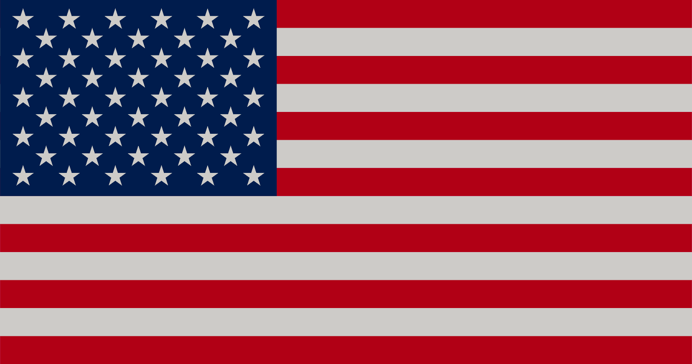
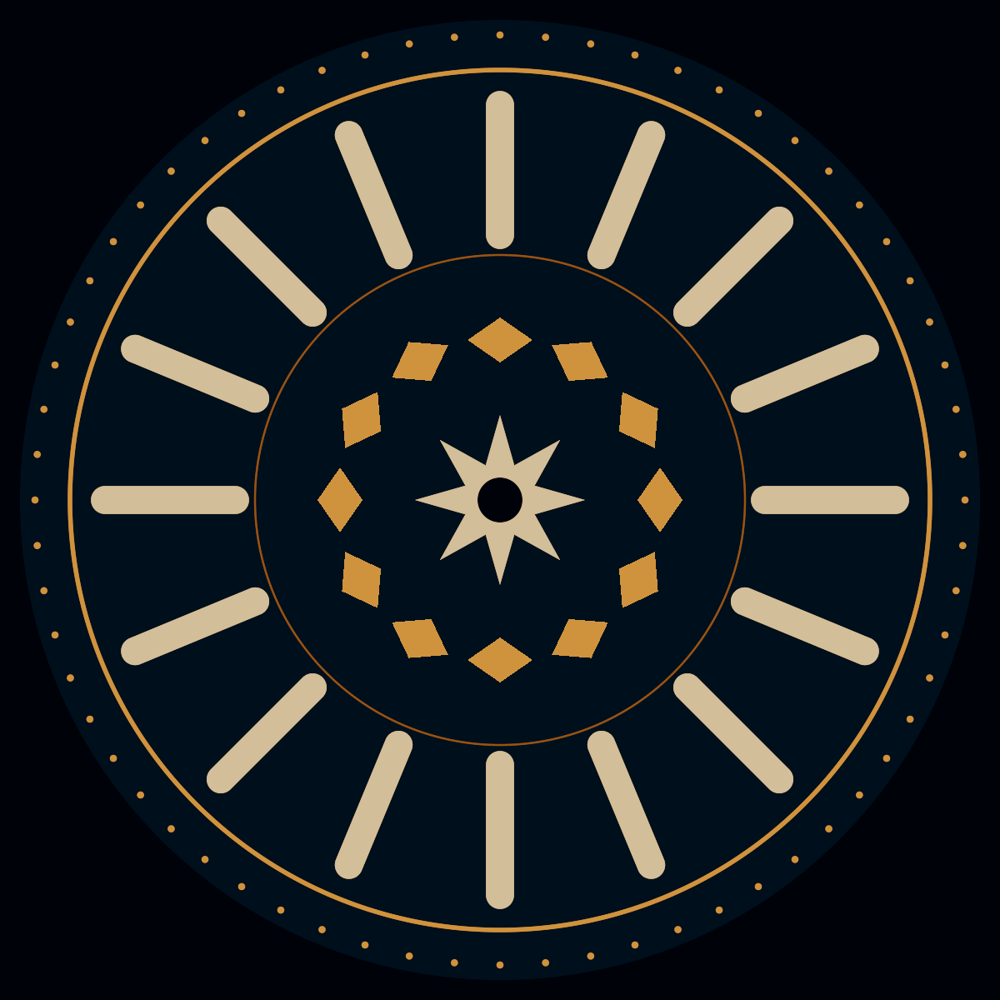
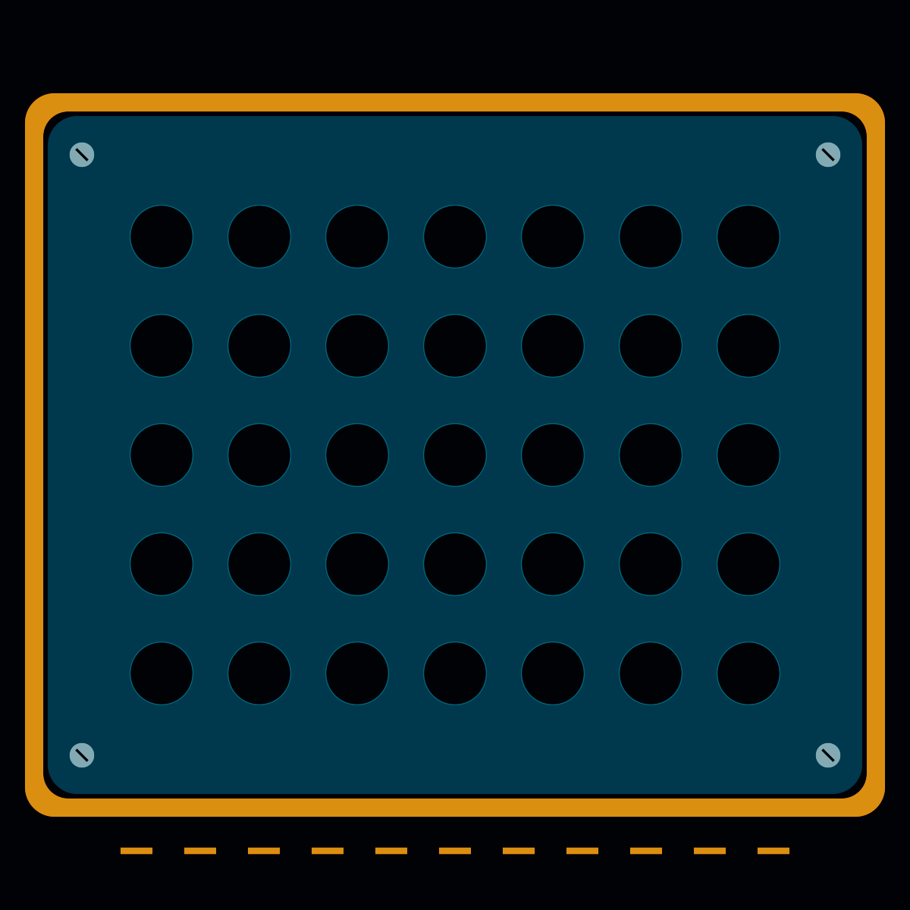
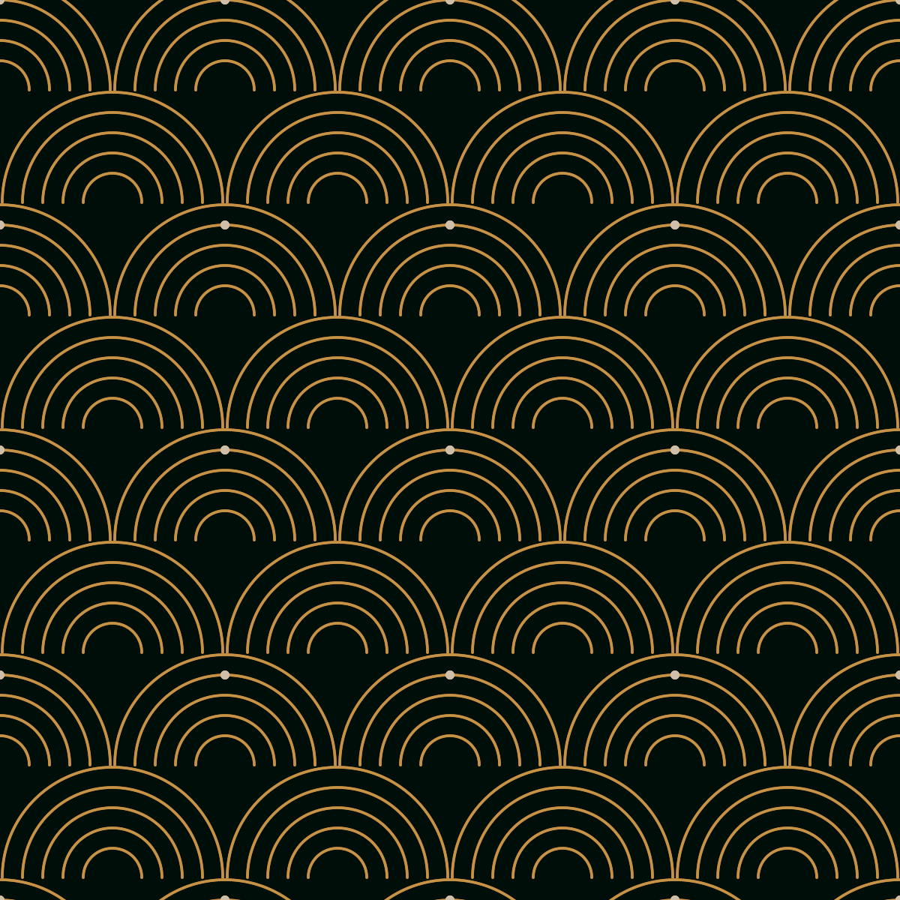
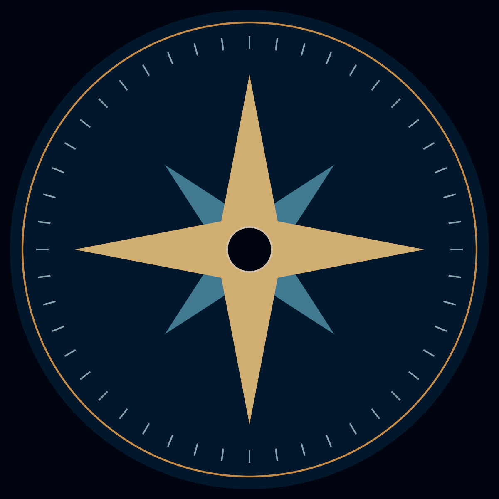

# SDF Showcase for 3ds Max

Five editable examples made with the IMAN SHIRANI OSL SDF toolkit.
Built and rendered with 3ds Max 2027.2.

## Examples

| Scene | Construction | Useful controls |
| --- | --- | --- |
| 01_American_Flag.max | Thirteen stripes, a blue canton and alternating 6×5 / 5×4 star arrays. | Array counts and spacing; Rectangle half-size; colors in Flag_* maps. |
| 02_Gold_Mandala.max | Concentric rings, sixteen capsule petals, twelve diamonds and sixty-four outer dots. | Repetitions, Placement_Radius, capsule Radius, Shell Thickness and colors. |
| 03_Perforated_Panel.max | Rounded panel minus a 7×5 circular hole array, frame, corner screws and indicators. | Hole radius, array spacing/counts, panel Size and CornerRadius. |
| 04_Art_Deco_Pattern.max | Staggered arrays of concentric open arcs with accent dots. | Arc Radius/Thickness, array spacing and palette. |
| 05_Compass_Emblem.max | Two four-point stars, concentric rings and forty-eight radial ticks. | Triangle vertices, circle Radius, radial repetitions and ring thickness. |

## Preview

## Opening and editing

Open a .max scene in 3ds Max 2027 or a compatible later version. Each scene has a plane,
its procedural material and a Scanline test camera. The shader graphs are editable.
Select the plane and retrieve its material into Slate to inspect the upstream nodes.
The first Material Editor slot also holds the example material.

Toolkit OSL source is embedded in the scene, including its original copyright/license
header. The examples do not require the creator's G: drive or external texture images.
They therefore use a snapshot of the shaders, rather than automatically following
later changes to an installed .osl file.

## Construction notes

Straight-sided stars are composed from five triangle fields and a central circle;
four/eight-point variants use the corresponding number of triangles. The existing
SDF_Star shader is not used in these examples because its current mask has curved sides.
This composition demonstrates silhouette construction; union fields are not guaranteed
to remain exact Euclidean distance at internal overlap boundaries.

Embedded Demo_Color_Mix maps combine mask colors with palette colors.
The flag also uses Demo_Aspect_Compensation to preserve physical star proportions on
the 1.9:1 plane. These helper maps perform color/coordinate operations; the shape,
array, radial, shell and Boolean construction uses the toolkit.

The examples are procedural material masks, not generated mesh objects.
The flag is a demonstration of arrangement and shape composition, not a certified
manufacturing specification. The toolkit source files were not modified to make it.

## Rebuilding

build_showcase.py builds the five scenes through 3dsmaxbatch.exe on the creator's
workspace. Its input paths are specific to that workspace; the saved .max examples
embed their shader code and are intended for sharing independently.
